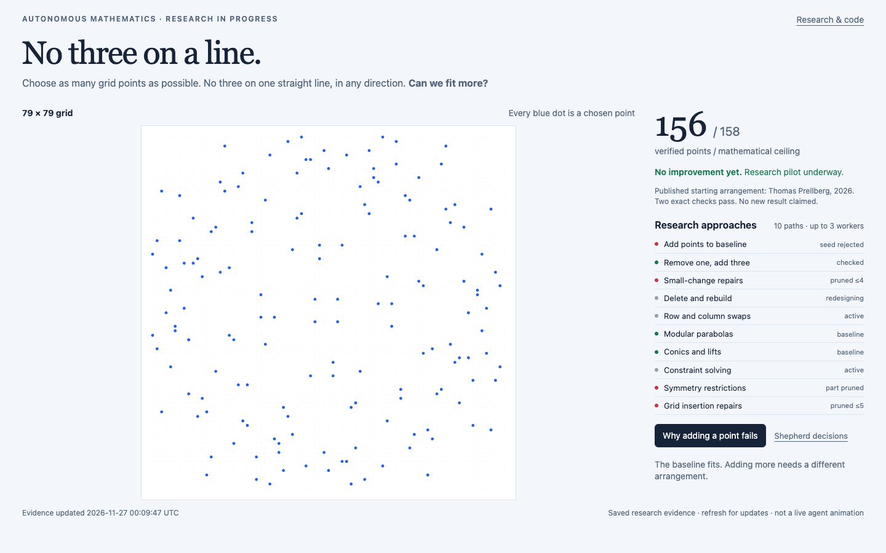

# No three in a line: autonomous mathematical research

**[Open the research visualization](https://deepujain.github.io/no-three-in-line-research/)** · [Research plan](research/PLAN.md) · [Shepherd decisions](research/decisions.md)

Choose as many points as possible on a square grid. **No three chosen points may lie on one straight line, in any direction.**

We are investigating a **79 × 79 grid**. A published arrangement gives us **156 points**. Every row can hold at most two, so **158 is the mathematical ceiling**. Can a different arrangement fit 157 or 158? The general problem remains open; current finite records must be checked separately for each size.

**Current result: no improvement.** The 156-point starting arrangement is Thomas Prellberg's published 78 × 78 construction, embedded in the larger grid. It is not our discovery. We have not established a complete global record for near-miss arrangements at order 79, so a future 157-point certificate would initially be an improvement over our witnessed baseline, pending a fresh novelty check.



The page shows saved evidence, rather than animated or continuously connected agents. Refresh after published updates. The arrangement, question, and result are visible immediately; an optional button shows an exact example of why an extra point would create a forbidden line. On compact phones, the approach list is summarized to preserve space for the board. No installation or walkthrough is required. To run offline, download [index.html](https://github.com/deepujain/no-three-in-line-research/raw/refs/heads/main/index.html) and open it in a browser.

**Background:** [Wikipedia: No-three-in-line problem](https://en.wikipedia.org/wiki/No-three-in-line_problem).

## Autonomous research team

The Research Lead is the **shepherd**: it chooses work, allocates resources, reviews findings, stops unproductive branches, and opens new branches without requiring hourly human direction.

| Real-world role | Actual agent | Model and reasoning | Work in the first round |
| --- | --- | --- | --- |
| Research Lead | Parent agent | Session default; identifier not exposed to the agent | Allocated work, integrated evidence, built the public research view, configured continuations. |
| Literature Researcher | `literature_researcher` | GPT-6.1 Terra · high | Checked current sources, imported the attributed baseline, distinguished records from conservative bounds. |
| Mathematician | `mathematician` | GPT-6 Astra · high | Derived baseline proofs, examined symmetry restrictions, proposed constructions; subsequently independently reviewed the engineer’s guided-repair audit. |
| Research Software Engineer | `research_software_engineer` | GPT-6.1 Sol · high | Built exact verifiers, bounded searches, tests, and an exhaustive blocker audit. |
| Mathematical Reviewer | `literature_researcher`, subsequent task | GPT-6.1 Terra · high | Independently reviewed the Mathematician's claims and wrote a separate one-hole audit. This reused the literature agent; it was not a fifth concurrent agent. |

These are actual assignments, not fictitious people. Different agent tasks do not establish statistical independence or eliminate shared model blind spots. Mathematical checking and exact certificate validation are essential. [Agent roster](research/agents.json) · [Mathematical review](research/review.md)

## Ten approaches, not ten simultaneous workers

We maintain [ten approach branches](research/approaches.json), with at most **three workers plus the shepherd** running concurrently. They include boundary repairs, row/column trades, variable-cardinality repair, modular and conic constructions, constraint solving, symmetry restrictions, and transfers between nearby grids. Some are queued, some tested, and some rejected only within a stated family. The [Mathematician's broader proposal](research/mathematics.md) describes additional mechanisms and cheap tests; proposals are not executed experiments.

Workers receive new tasks as they finish. A bounded numerical experiment pool runs between model reviews, a five-minute dispatcher checks for work needing assignment, and formal synthesis remains hourly. The pilot runs from **26 November 2026, 22:59 UTC through 27 November 2026, 22:59 UTC**. Scheduled model execution depends on the Codex desktop scheduler, the host being available, and account limits. The numerical supervisor is a program, not an always-on AI model service. [Resource and stopping rules](research/PLAN.md)

## What the first round established

- Both exact geometry checks accept the 156-point published baseline.
- No point can simply be added to any of its four corner translations into the 79-grid. This concerns that seed, not all possible 156-point arrangements.
- The independent reviewer checked **624 one-hole boundary extensions**, none valid. This exhausts only that precisely defined family. [Audit](data/one-hole-audit.json)
- Exact quarter-turn symmetry cannot attain 158 on this odd-sized grid, by orbit cardinality. This does not exclude half-turn symmetry or catalogued near-quarter-turn patterns. [Proof and review](research/review.md)
- Four five-second deletion-and-repair trials retained 156 points. Search failure is not an impossibility proof. [Recorded runs](data/smoke-summary.json)
- All **24,340 empty cells** across the four translated seeds were audited for disjoint blocking pairs. Every new insertion needs at least two old deletions. This test alone did not exclude budgets of two or three; the stronger audit below does. [Blocker audit](data/blocker-audit.json)
- A subsequent, stronger **complete guided audit** checked all **5,824 relevant deletion sets** across these four seeds. None can improve the point count with at most three original-seed deletions, even allowing removed points to be reinserted. This retires that neighborhood; it does not exclude larger changes or other arrangements. [Audit](data/guided-repair-audit.json) · [Independent review](research/guided-review.md)

## Following research rounds

Work continues beyond the initial small-change audit:

- The full four-deletion corner audit completed: 130,290 relevant deletion sets per corner, no improvement. Together with the reviewed nonuniform-insertion audit, all 6,241 row/column embeddings of this seed are excluded through four deletions. This remains a seed-specific result.
- All 6,237 nonuniform embeddings are now excluded through five original-point deletions. Each of the last two representative streams completed 596,904 deletion sets; an independent reviewer checked every hash-linked record and its no-witness counters. The four corner embeddings remain excluded only through four deletions. These computational conclusions rely on the disclosed trusted computations, not an independent replay. [Summary](data/embedding-five-summary.json) · [Embedding review](research/embedding-review.md)
- Two SAT backends each added 1.5 million exact geometric cuts, then stopped at their declared cut quota without a witness or UNSAT result. The numerical queue continues from validated geometry checkpoints. [SAT method and runs](research/sat.md)
- Row/column trades retain a separately verified 156-point incumbent. Their 158-point search states remain invalid. The complete component with conflict score at most 13 contains 36 states and never improves the starting score of 11. This establishes a local barrier for one state and move family; it gives no global nonexistence result. [Trade results](research/trades.md) · [Review](research/trades-review.md)

The queue, real process receipts, and [Research Lead decisions](research/decisions.md) distinguish running experiments, incomplete searches, scoped exhaustive results, and valid certificates. No new point-count record is claimed.

## Reproduce and verify

Python 3.9+; no third-party Python dependencies:

```sh
python3 -m unittest discover -s tests -v
python3 src/verify.py data/published-n78.json
python3 src/verify.py data/published-n78.json --brute-force
python3 research/review_one_hole.py
python3 research/blocker_audit.py
python3 research/guided_repair.py --seconds 60
python3 src/build_site.py
```

The first verifier groups exact normalized integer slopes. The second independently tests integer determinants of every triple. Both reject duplicates, out-of-grid coordinates, floats, and Boolean coordinates. Certificate hashes cover only the normalized grid size and sorted points. They verify a construction, not its novelty or optimality. Proofs have received agent review but are not formalized in a proof assistant.

Example bounded search, preserving the published incumbent:

```sh
python3 src/search.py --n 79 --initial data/published-n78.json \
  --seconds 30 --seed 20261126 --delete-count 3 --output data/example-run.json
```

Each saved run records its seed, method, time, iterations, stopping reason, and exact checks. Wall-clock stopping means the same seed and requested duration can execute a different number of iterations on another machine. See [engineering notes](research/engineering.md).

Optional browser tests use Playwright and Chrome:

```sh
node test_ui.cjs
```

They check desktop and phone layouts, absence of initial page scrolling, the exact conflict example, keyboard operation, and JavaScript errors. The visualization itself needs no dependencies.

Optional SAT research uses an isolated Python environment and the versions pinned in `requirements-research.txt`:

```sh
python3 -m venv .venv
.venv/bin/python -m pip install -r requirements-research.txt
.venv/bin/python -m unittest discover -s tests -p 'test_*sat.py' -v
```

The new [symmetry SAT branches](research/symmetry-sat.md) test diagonal-reflection arrangements with 157 points and half-turn arrangements with 158. Their failure would exclude only those invariant families. [Independent review](research/symmetry-review.md)

The numerical supervisor uses host process inspection (`ps`) for its memory guard. Run its process tests and experiments where that inspection is permitted; it fails closed if the guard cannot operate. Its deadline and recovery assumptions are documented in [the supervisor review](research/supervisor-review.md). It is not an AI agent.

## Research output and publication

A successful construction will be saved with full coordinates, exact verification, provenance, and a fresh literature comparison. A candidate reaching 158 would meet the elementary upper bound and prove optimality for this one grid size. It would not solve the general asymptotic question. If nothing improves, the final report will say so and preserve useful negative evidence.

The intended scholarly output, if the result merits it, is a paper backed by this repository and an archived release. No journal acceptance, preprint submission, or discovery is claimed. Paper submissions and contacting researchers are separate human decisions. AI contributions and human responsibility must follow the chosen venue's policy.

## Attribution and prior work

The imported construction is credited to **Thomas Prellberg**, discovered 28 October 2026, distributed in [Achim Flammenkamp's no-three-in-line database](https://wwwhomes.uni-bielefeld.de/achim/no3in/readme.html). The encoded source, alphabet, source URL, and hashes are preserved in [the certificate](data/published-n78.json). No explicit data reuse license was identified; no blanket project license is asserted over third-party material. Source programs from that database were not copied.

The primary database and [Queen Mary University's 20 November report](https://www.seresearch.qmul.ac.uk/ccs/news/5792/a-120-year-old-puzzle-a-new-world-record-and-a-student-project/) supersede older benchmark snapshots for the order-78 construction. Read the [literature ledger](research/literature.md) and [conservative bounds](data/baselines.json) for source dates, uncertainty, and the distinction between finite records and asymptotic research.
